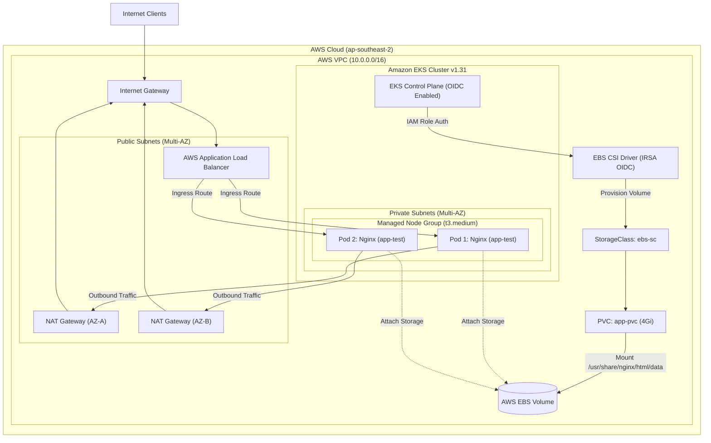

# AWS EKS Technical Architecture

This repo is aimed for hihgly avaiable EKS clusters



## Prequistites
* **AWS CLI**: '>=2.x'
* **Terraform**: '>=1.5.0'
* **Hashicorp/AWS**: '~> 5.0.0'
* **kubectl**: '>=1.31.x'
* **terraform-aws-modules/eks/aws**: '~> 20.0'
  
## Deploy Instructions

### Phase 1: Infrastructure Provisiong (Terraform)
```bash
    terraform init
    terraform fmt
    terraform validate
    terraform plan
    terraform apply --auto-approve
```

### Phase 2: Kubernetes Deployment
- `aws eks update-kubeconfig --region ap-southeast-2 --name testing-k8s-cluster --profile testing-session`
- `kubectl apply -f k8s-app.yml`


### Phase 3: Validation
1. Verify Nodes:
    - `kubectl get nodes -o wide`
2. Verify Pods and PVC and screenshot:
    - `kubectl get pods -n app-test -o wide`
    - `kubectl get pvc -n app-test`
    - `kubectl describe pod -n app-test -l app.kubernetes.io/name=sample-app`
3. Test Connectivity:
    - curl -I URL

### Phase 4: Cleanup Instruction
1. `kubectl delete -f k8s-app.yml`
1. `terrform destroy --auto-approve`
1. `terrform plan`